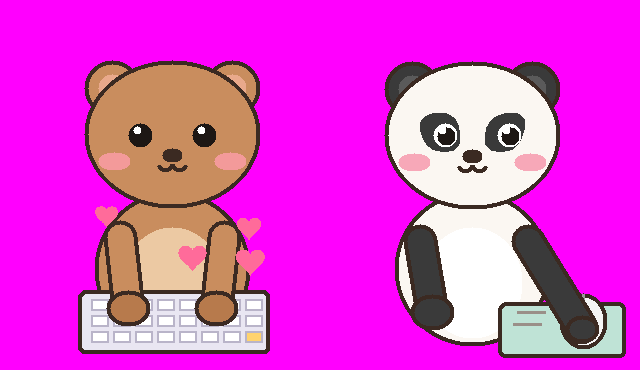
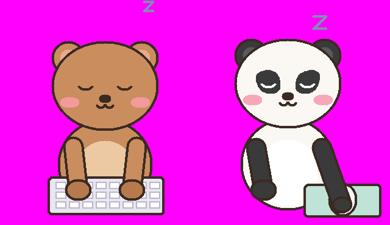

# Bubu & Dudu — یک «پت» کوچولو برای دسکتاپ ویندوز

- **بوبو** (خرس قهوه‌ای، سمت چپ): وقتی شما تایپ می‌کنید، روی کیبوردش تایپ می‌کند.
- **دودو** (خرس سفید با گوش و دور چشم مشکی، سمت راست): وقتی موس را حرکت می‌دهید یا کلیک می‌کنید، موسش را تکان می‌دهد و چشم‌هایش نشانگر موس را دنبال می‌کند.
- اگر ۴۵ ثانیه کاری نکنید، هر دو می‌خوابند (zZ). گاهی هم به هم نگاه می‌کنند و قلب می‌فرستند.
- همیشه روی همه‌ی برنامه‌ها می‌ماند (Always on top) و پس‌زمینه‌اش شفاف است.

## کنترل‌ها
| کار | چطور |
|---|---|
| جابه‌جا کردن | با کلیک چپ بگیرید و بکشید |
| منو | کلیک راست روی خرس‌ها |
| رفتن به یک گوشه‌ی صفحه | منو ← Move to corner |
| اندازه (کوچک/متوسط/بزرگ) | منو ← Size |
| روشن/خاموش کردن «همیشه رو» | منو ← Always on top |
| اجرای خودکار با روشن شدن ویندوز | منو ← Start with Windows |
| بستن | منو ← Exit |

جا و اندازه ذخیره می‌شود (`%APPDATA%\BubuDudu\config.json`) و دفعه‌ی بعد همان‌جا باز می‌شود.

## نصب

### روش ۱ — فایل exe (بدون نیاز به پایتون)
1. در GitHub به تب **Actions** بروید ← workflow به اسم **Build Bubu & Dudu** ← آخرین اجرای موفق.
2. پایین صفحه از قسمت **Artifacts** فایل `BubuDudu-windows` را دانلود و unzip کنید.
3. `BubuDudu.exe` را جایی مثل `Documents` بگذارید و اجرا کنید.
   - چون فایل امضای دیجیتال ندارد، ویندوز ممکن است پیغام SmartScreen بدهد: **More info ← Run anyway**.
   - بعضی آنتی‌ویروس‌ها به exeهای ساخته‌شده با PyInstaller اشتباهاً گیر می‌دهند؛ اگر این‌طور شد از روش ۲ استفاده کنید.
4. اگر می‌خواهید با ویندوز خودش اجرا شود، از منوی کلیک راست **Start with Windows** را تیک بزنید.

### روش ۲ — با پایتون
1. پایتون را از [python.org](https://www.python.org/downloads/) نصب کنید (tkinter همراهش هست).
2. این پوشه (`desktop-pet`) را دانلود کنید و روی `run_bubu_dudu.bat` (یا مستقیم `bubu_dudu.pyw`) دوبار کلیک کنید.

## حذف کامل
1. کلیک راست ← تیک **Start with Windows** را بردارید (اگر زده بودید) ← **Exit**.
2. فایل exe (یا پوشه) و پوشه‌ی `%APPDATA%\BubuDudu` را پاک کنید. همین؛ هیچ چیز دیگری نصب نمی‌شود.

## حریم خصوصی
برنامه فقط چک می‌کند که «آیا کلیدی فشرده شده یا نه» تا بوبو تایپ کند؛ **اینکه کدام کلید بوده را نه ذخیره می‌کند، نه جایی می‌فرستد**. هیچ ارتباط اینترنتی ندارد. کد کامل در `bubu_dudu.pyw` است (فقط کتابخانه‌های استاندارد پایتون).

## شخصی‌سازی
رنگ‌ها در بالای `bubu_dudu.pyw` در `BUBU` و `DUDU` تعریف شده‌اند؛ اگر می‌خواهید جای رنگ دو شخصیت عوض شود، همان‌جا عوضشان کنید. `SLEEP_AFTER` زمان خوابیدن را تعیین می‌کند. برای دیدن انیمیشن بدون تایپ: `pythonw bubu_dudu.pyw --demo`.
